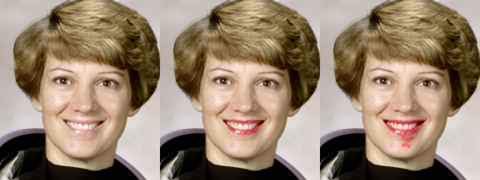

# ShadeSense

One selfie in, and out come the skin tone (Monk Skin Tone 1–10), the undertone, the 3 closest foundation
shades, lipstick suggestions and a virtual try-on. Built for CS 5130, Theme 2 (Representation Learning
& Data Pipelines).

The research question is: does a frozen **DINOv2** embedding of the skin estimate colour more reliably
than the hand-crafted **median CIELAB** colour when the lighting changes? Both methods feed the same
shade matcher, so any difference comes from the representation.



## Pipeline

| # | Module | File | Owner |
|---|---|---|---|
| 1 | Ingest & validate: reject blurry, badly exposed or no-face images; split **by identity** | `shadesense/ingest.py` | Member 1 |
| 2 | Face segmentation: MediaPipe landmarks (baseline) or SegFormer face parser (proposed) → skin and lip masks | `shadesense/segment.py` | Member 2 |
| 3 | Lighting fix: shades-of-gray white balance estimated from pixels around the face; CIELAB | `shadesense/lighting.py` | Member 2 |
| 4 | Features: median LAB (baseline) vs DINOv2 + ridge head → LAB (proposed) | `shadesense/features.py` | Member 3 |
| 5 | Store: Parquet features, product catalogue with a FAISS index | `shadesense/store.py` | Member 3 |
| 6 | Match: FAISS shortlist re-ranked by ΔE2000 → top 3; undertone → lipstick family | `shadesense/match.py` | Member 3 |
| 7 | Try-on: recolour the lip mask in LAB, keeping texture | `shadesense/tryon.py` | Member 4 |
| 8 | Evaluation: shade accuracy under lighting changes, per skin-tone group, mIoU, latency | `shadesense/evaluate.py` | Member 4 |

`shadesense/pipeline.py` wraps everything as `ShadeSense(cfg).analyze(image)`, and
`shadesense/colour.py` holds the shared colour maths (ΔE2000, MST, hue angle). One `config.yaml`
drives every stage.

## Setup

MediaPipe needs **Python 3.9–3.12**, so create a separate environment:

```bash
conda create -n shadesense python=3.11 -y
```

```bash
conda activate shadesense
```

```bash
make install
```

## Check it works (no downloads except DINOv2-small, about 90 MB)

```bash
make test
```

```bash
make smoke
```

`make smoke` generates 40 cartoon faces with known skin colours across all 10 MST tones, plus a fake
120-shade catalogue ("DemoBrand"). It then runs ingest → extract → train → evaluate with ground-truth
masks. The results land in `results/synthetic/`. This only tests the plumbing: synthetic faces say
nothing about real ones.

Analyse one image:

```bash
python -m shadesense analyze --image path/to/selfie.jpg --out tryon.png
```

## Real data

| Data | Where to put it | Used for |
|---|---|---|
| **Team selfies** (with written consent) | `data/raw/team_selfies/<person>/<condition>.jpg`, one `neutral.jpg` per person (daylight, no filter) plus e.g. `warm_lamp.jpg`, `cool_led.jpg` | Ground truth: same face, different light → same shade? |
| **Makeup Shades** (The Pudding, also on Kaggle) | `data/raw/makeup_shades/shades.csv`; brand / product / hex columns are detected automatically | The real shade catalogue (the demo catalogue is used until this exists) |
| **CelebAMask-HQ** | `data/raw/CelebAMask-HQ/`, then `python scripts/prepare_celebamask.py` | Segmentation mIoU, `configs/celebamask.yaml` |
| **FFHQ** subset | `data/raw/ffhq/`, plus a CSV of hand-labelled MST values (`dataset.mst_labels`) | Fairness: every metric per MST group |
| **MT makeup** dataset | `data/raw/mt/` | Lipstick colours on real lips, try-on checks |

Then run:

```bash
python -m shadesense pipeline --config config.yaml
```

Optional label files (`image_id,mst` and `image_id,undertone`) turn on the per-group fairness numbers
with real labels, and the undertone classifier.

## Outputs (results/<dataset>/)

| File | Answers |
|---|---|
| `overall.csv` | Top-1 / top-3 shade accuracy and mean ΔE for raw, baseline and proposed, on original photos, under lighting changes, and under blur / JPEG |
| `by_view.csv`, `top3_by_view.png` | The same, per lighting condition (warm lamp, cool LED, dim, bright, green cast) |
| `by_mst_group.csv`, `top3_by_mst_group.png` | Fairness: accuracy for MST 1–3, 4–7 and 8–10 |
| `summary.json` | H1 McNemar test (proposed vs baseline), H2 gap between skin-tone groups, undertone accuracy and F1, latency p50/p95, storage per image |
| `segmentation.csv` | Skin and lip mIoU against ground-truth masks |
| `per_image.csv` | Every prediction, for failure analysis |

Methods compared: **raw** is the median LAB with no lighting fix, **baseline** is the median LAB after
the lighting fix, and **proposed** is DINOv2 + colour head.

## Demo and web API

```bash
make demo
```

```bash
make api
```

Then send an image to the API:

```bash
curl -F "file=@selfie.jpg" http://127.0.0.1:8000/analyze
```

The API returns JSON plus a base64 try-on PNG. Images are processed in memory and never stored. To
deploy, put the Streamlit app on Hugging Face Spaces, or FastAPI in Docker on Render or Spaces.

## What has been verified, and what we found

- All 23 unit tests pass, and `make smoke` runs end to end on Python 3.12.
- The real-photo path works: MediaPipe and SegFormer both segment a real face, and `POST /analyze`
  returns a result in about 170 ms on a laptop CPU.
- **White balance can hurt.** On a photo with a coloured background (reddish hair, a flag), every
  correction tested made the skin colour *worse* than no correction. Gray-world was off by ΔE 19;
  capped shades-of-gray, now the default, by ΔE 8. On gray walls, correction cuts the error from
  about 4 to 1.5. Decide on the team selfies: `evaluate` reports `raw` next to `baseline` for exactly
  this.
- **The SegFormer lip mask spills onto the chin** on some faces. Teeth, surrounding skin and specks
  are filtered out, but a mislabelled chin patch remains. MediaPipe landmarks give cleaner lips and
  are the default.
- **The DINOv2 head is weak on the smoke set** (28 training faces). This is expected; judge it on real
  data.
- The MST reference colours in `colour.py` and the lipstick colours in `match.py` are illustrative.
  Check the MST values against the official Monk Skin Tone page before the report.

## Repository rules

`main` is protected. Work on a branch per module, open a PR, and merge after 1 review and passing CI
(`.github/workflows/tests.yml`). Data, results and model files are git-ignored.
